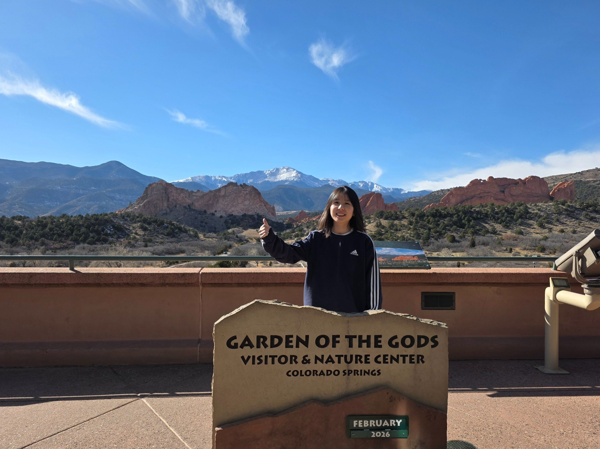

```{=html}
<div role="main">
<div class="site-container page-shell">
<header class="page-hero"><div class="kicker">Beyond the lab</div><h1>Photos</h1></header>
<section class="photo-gallery" aria-label="Photo gallery">
  <figure class="photo-feature"><a href="images/eunji-photo-original.jpg" target="_blank" rel="noopener noreferrer" aria-label="View full-size photo from Garden of the Gods"></a><figcaption><strong>Garden of the Gods</strong><span>Colorado Springs, Colorado · February 2026</span></figcaption></figure>
</section>
<p class="gallery-note">More photos to come.</p>
</div>
</div>
```
