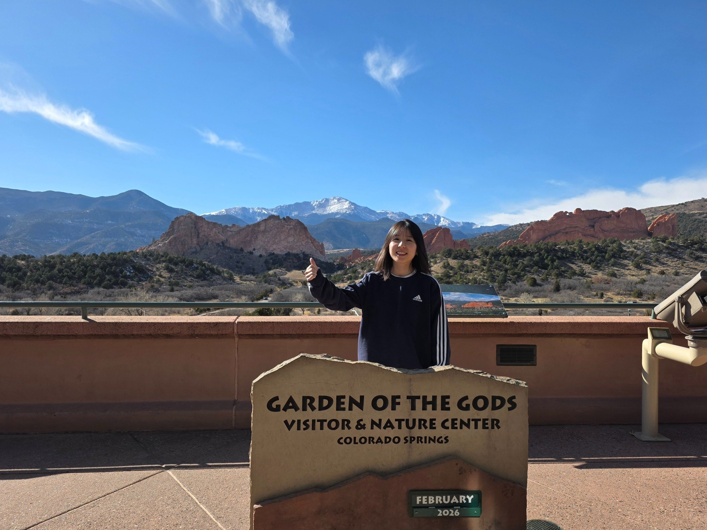

```{=html}
<div role="main">
<div class="site-container page-shell">
<header class="page-hero"><div class="kicker">Beyond the lab</div><h1>Photos</h1></header>
<section class="photo-gallery" aria-label="Photo gallery">
  <figure class="photo-feature"><a href="images/eunji-photo-original.jpg" target="_blank" rel="noopener noreferrer" aria-label="View full-size Garden of the Gods photo"></a><figcaption><strong>Garden of the Gods</strong><span>Colorado Springs, USA · Feb 2026</span></figcaption></figure>
  <div class="photo-placeholder" aria-label="Photo slot 2 — image to be added later"><span class="photo-placeholder-icon" aria-hidden="true">+</span><span>Photo coming soon</span></div>
  <div class="photo-placeholder" aria-label="Photo slot 3 — image to be added later"><span class="photo-placeholder-icon" aria-hidden="true">+</span><span>Photo coming soon</span></div>
  <div class="photo-placeholder" aria-label="Photo slot 4 — image to be added later"><span class="photo-placeholder-icon" aria-hidden="true">+</span><span>Photo coming soon</span></div>
  <div class="photo-placeholder" aria-label="Photo slot 5 — image to be added later"><span class="photo-placeholder-icon" aria-hidden="true">+</span><span>Photo coming soon</span></div>
  <div class="photo-placeholder" aria-label="Photo slot 6 — image to be added later"><span class="photo-placeholder-icon" aria-hidden="true">+</span><span>Photo coming soon</span></div>
</section>

</div>
</div>
```
